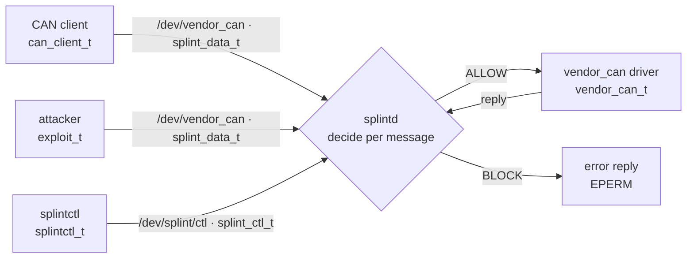

<!-- SPDX-License-Identifier: Apache-2.0 -->
# QSplintNX

Virtual patching for QNX 8 resource managers.

When a driver on a QNX system has a known vulnerability and ships as a
binary from a supplier, the integrator cannot rebuild it and has to wait
for a fixed binary. On the web this gap is covered by virtual patching: a
rule in a WAF or IPS blocks the exploit while the real fix is prepared.
QSplintNX brings that idea inside the operating system. A daemon,
`splintd`, sits in front of a driver in the QNX pathname space, inspects
every message by its protocol semantics (operation, devctl code, declared
versus real length, payload fields) and blocks the ones that match a known
exploit, with no change to the driver and no restart.

Concretely, `splintd` owns the driver's public path: in relocated mode the
real driver is started on a private path and `splintd` registers the public
one; in shadow mode `splintd` attaches the same path ahead of the driver
with `_RESMGR_FLAG_BEFORE`. Either way a client's `open`/`read`/`write`/
`devctl` messages land on `splintd`, which runs them past the ruleset and
forwards the allowed ones to the real driver over its own connection. A QNX
security policy (secpol) grants `channel connect` to the driver's channel
only to `splintd`'s type, so no other process can reach the driver except
through `splintd`; that is what closes the bypass.

The device clients and the control client reach `splintd` over two separate,
separately typed channels: `splint_data_t` carries `open`/`read`/`write`/`devctl`
for the protected device, `splint_ctl_t` carries only control traffic from
`splintctl` (reload, stats, events). secpol lets device clients connect to the
first and only `splintctl` to the second, and it lets only `splintd` connect to
the driver's own `vendor_can_t` channel. A client that tries the driver path
directly, or tries the control channel, is refused by the kernel at the connect.

Because that deny lives in the kernel's secpol and not inside `splintd`, a crash
of `splintd` cannot re-expose the driver in relocated mode: the public node
disappears and clients get ENOENT, while the direct-to-driver path stays denied,
so the failure is closed rather than open. Shadow mode makes the opposite trade
(the driver keeps its node and stays reachable, unprotected, if `splintd` dies).
Supervising `splintd` so it respawns turns the outage into a sub-second gap; the
production mechanism is the QNX High Availability Manager. See
`docs/AVAILABILITY.md` for the measured crash, denial and recovery behaviour.

Inspection is stateless and per-message: each message is judged on its own
operation, devctl code, declared-versus-actual length and fixed-offset
payload fields. This catches the classic length-confusion, bad-command and
malformed-argument bugs. It deliberately does not reconstruct deep stateful
protocol sequences across many messages, and it does not see data a client
moves out of band through shared memory; those are out of scope.

The rule language is deliberately small, with no loops and no regular
expressions, so the number of comparisons needed to check one message is
bounded. That bounds the rule-evaluation cost; it is not by itself a hard
real-time latency guarantee, since the rate limiter takes a short lock and
every allowed message waits on backend I/O, both of which depend on scheduling
and contention. On a QNX 8.0 x86_64 target under QEMU/KVM, deciding one message
(the step that blocks a known-bad devctl) took about 1 microsecond, and
`bench/bench_ipc` put the median cost `splintd` adds at roughly 37 microseconds
per message on an idle box, rising to about 47 with a second client saturating
it; the gap between the two paths' 99th percentile sat near 145 and 207
microseconds. Nearly all of that is the extra IPC hop to the backend rather than
the decision, and the floor is one round trip (~7.6 microseconds) that does not
move under load. Those are emulated figures; see `docs/qemu-validation.md` for
the full run, including why the percentile differences are not the percentiles
of per-request overhead, and re-measure on a board before quoting them as
hardware numbers.

## Status

QNX Global Hackathon 2026 entry, Automotive & Mobility. Under active
development. The portable core (rule language, decision engine, learn
mode, event log) builds and is unit-tested on Linux; the QNX daemon and
tools are written against the QNX SDP 8.0 documentation and are validated
on a QEMU target as the SDK is installed.

## Layout

    include/splint/   public headers (portable)
    src/core/         rule language, engine, learn mode, log (portable C11)
    src/qnx/          splintd: the QNX interposing resource manager
    tools/splintctl/  control client (reload, stats, events, learn-dump)
    tools/secpolgen/  generate the secpol policy that closes the bypass
    bench/            host engine benchmark and on-target IPC benchmark
    demo/             vendor driver scenario, clients, rules, run scripts
    docs/RULES.md     the rule language, normative
    docs/PLAN.md      development plan and on-target spikes
    docs/AVAILABILITY.md      what happens to the device when splintd crashes
    docs/qemu-validation.md   the full on-target run (forwarding, patch,
                              shadow mode, latency, secpol bypass + isolation)

## Build

Host (Linux, gcc):

    make test        # build the core and run all unit tests
    make sanitize    # the same under AddressSanitizer + UBSan
    make bench       # engine latency micro-benchmark

QNX (after installing QNX SDP 8.0 and sourcing its environment):

    source ~/qnx800/qnxsdp-env.sh
    make qnx

This builds `splintd`, `splintctl`, `bench_ipc` and the demo driver and clients
for `gcc_ntox86_64`.

## Run it on QNX

The whole demo runs on a QEMU target built from the SDP, so it reproduces without
hardware. The steps:

1. Generate the security policy from the scenario config and build an image with
   it. `secpolgen` turns a small JSON description of `splintd`, its control client
   and the driver mappings into the secpol policy that types the channels and
   closes the bypass:

        python3 tools/secpolgen/secpolgen.py tools/secpolgen/example.json \
            -o demo/secpol/qsplint.secpol
        mkqnximage --secpol=develop --policy=demo/secpol/qsplint.secpol --clean

2. Boot the image under QEMU (KVM if available) and copy the binaries, rules and
   `demo/*.sh` onto the target (the demo uses a FAT payload drive; any transport
   works).

3. Run the scenarios on the target:

        SECPOL=1 ./run_demo.sh      # forward, crash unpatched, patch live, block,
                                    # then the S2 bypass and control-channel checks
        ./run_shadow.sh             # same-path interposition (_RESMGR_FLAG_BEFORE)
        LOAD=1 ./run_bench.sh       # per-message min/p50/p99/max, under a flood

`docs/qemu-validation.md` is the transcript of exactly these runs on the secure
image, including the secpol denials logged by the kernel.

## License

Apache-2.0. See LICENSE.
